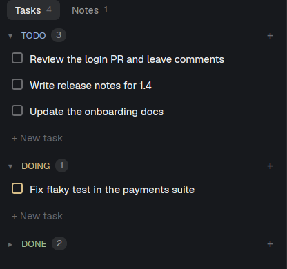

# herdr-notes

A tasks and notes panel for the [Herdr](https://herdr.dev) desktop app, in the
left sidebar under Agents.



- **Tasks:** Todo, Doing and Done, stacked and collapsible. Drag a task to
  another section to change its status, or within one to reorder it.
- **Notes:** a searchable list of notes; a note opens in place for editing.
- **Your data, in one file:** `~/.herdr-notes/data.json` by default, saved on
  every change. Edit it outside (by hand, a script, an agent) and the panel
  picks the change up; its own pending changes are merged on top.

The mod reads and writes only its data file (and creates its folder with
`mkdir -p`). It doesn't reach the network.

## Requirements

- The Herdr desktop app (tested with `herdr-app` 0.1.15) on Linux or macOS.
  Windows is untested: there the data file's folder must exist beforehand,
  and `install.sh` doesn't run.
- For `install.sh`: `bash`, `herdr-app` on the `PATH` and `python3` (on
  macOS, from the Xcode Command Line Tools or Homebrew).

## Install

**With an agent (the Herdr way).** In Herdr, ask your coding agent:

> Add the Herdr mod from https://github.com/pedrohb88/herdr-notes, following
> its RECIPE.md.

It copies `mods/herdr-notes`, merges `keys.json` into yours and puts the panel
in your layout, following Herdr's own guide.

**With the script.** With the Herdr app open, on a personal layout (Herdr's
own layouts can't be edited: duplicate one first from the command palette,
then switch to the copy):

```sh
git clone https://github.com/pedrohb88/herdr-notes
cd herdr-notes
./install.sh              # install or upgrade
./install.sh --uninstall  # remove the panel, the key and the mod (data stays)
```

It copies the mod to `~/.config/herdr-app/mods/herdr-notes`, checks it with
`herdr-app check`, adds the panel under Agents in the layout on screen and
binds `ctrl-shift-y` to show or hide it (only if the key is free).
`--uninstall` takes the panel out of every layout.

Either way, note that Herdr treats an edited `keys.json` as yours: new
default shortcuts from later Herdr releases are no longer added to it.

## Another data file

Give the panel's block a `file` prop in your layout (`~` is your home):

```json
{ "type": "block", "id": "herdr-notes", "content": { "mod": "herdr-notes", "props": { "file": "~/Sync/tasks.json" } } }
```

The panel watches the file's folder, so prefer a folder of its own over a
large one. Files over 1 MiB can't be read.

## Keys

`ctrl-shift-y` shows or hides the panel. With the panel focused (click it):

| Tasks | |
|---|---|
| ↑ / ↓ | select |
| Enter or F2 / double-click | edit (Enter saves, Esc cancels) |
| Shift+← / Shift+→ | previous / next status |
| Shift+↑ / Shift+↓ | move up / down |
| Space or the checkbox | Done (in Done: back to Todo) |
| n | new task |
| Delete or Backspace | delete (Enter confirms) |

| Notes | |
|---|---|
| / | search (Enter opens the first match) |
| ↑ / ↓, Enter | select, open |
| n | new note |
| Delete or Backspace | delete (Enter confirms) |
| Esc or the ← button | back to the list |

## Development

```sh
npm test                           # model.js unit tests (node:test)
herdr-app check mods/herdr-notes   # load the mod once and report problems
```

Design and decisions: [docs/design.md](docs/design.md).

## License

[MIT](LICENSE)
