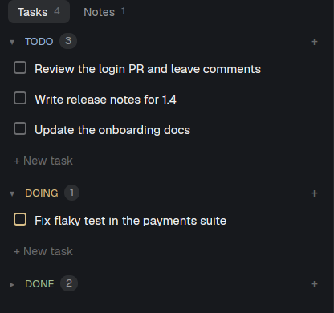

# herdr-notes

A tasks and notes panel in the left sidebar, under the Agents list. Two tabs:
Tasks, with Todo, Doing and Done sections you drag tasks between, and Notes,
a searchable list of plain-text notes that open in place. Everything lives in
one JSON file that other tools can edit too.

## What you see

Top to bottom, in a block about 1.2 weights tall (min 140px) under Agents:

- **Tab bar** (24px tabs, 8px padding, a 1px top border in the theme's
  `border`): "Tasks" with the count of tasks not Done, "Notes" with the
  note count. The active tab has the `raised` background and `foreground`
  text; the other is `muted`. "loading…" shows on the right until the file
  is read.
- **Error box**, only when the data file can't be read or isn't valid JSON:
  a rounded box tinted `ansi1` at 13% saying why, and that nothing is saved
  until it's fixed.
- **Tasks tab:** three section headers (26px), each with ▾/▸, the status in
  semibold caps (Todo `ansi4`, Doing `ansi3`, Done `ansi2`), a count pill and
  a `+` on the right. Under an open section: its tasks, then "+ New task" in
  `dim`. A task row has a 13px checkbox (outlined `dim` in Todo, outlined in
  the status color in Doing, filled with ✓ in Done), the text wrapped, and,
  when selected, ✎ and × buttons. Done tasks are struck through in `dim`.
  Done starts collapsed. With no tasks: "No tasks yet. Press n or click + New
  task."
- **Notes tab:** a search input, then rows with the title in semibold and a
  one-line preview of the body in `dim`, most recently edited first, then
  "+ New note". An open note replaces the list: a ← button, the title input
  and a soft-wrapped textarea filling the rest.
- Below 140px wide (the folded sidebar's rail) the panel draws nothing.

## How it behaves

- **Tasks:** click selects; double-click, Enter or F2 edits inline (Enter or
  leaving saves, Esc cancels). The checkbox or Space toggles Done (Done goes
  back to Todo). Drag a task onto another section to change its status, or
  within a section to reorder; a 2px line in the status color shows where it
  lands. Shift+←/→ moves to the previous/next status, Shift+↑/↓ reorders,
  `n` adds a task (Enter adds and keeps the field open), Delete or Backspace
  asks "Delete “…”?" inline (Enter or the Delete button confirms, Esc
  cancels). A task moved with the keyboard into a collapsed section opens it;
  one dragged there, or checked into a collapsed Done, stays hidden in it.
- **Notes:** `/` focuses search (title and body); from search, ↓ goes to
  the results and Enter opens the first match. ↑/↓ select, Enter or a click
  opens, `n` makes a new note, Delete or Backspace asks to confirm. In a note,
  Enter in the title goes to the body; Esc or the ← button goes back (the ←
  key moves the cursor). The note saves 600ms after the last keystroke and on
  leaving; a note left empty is deleted.
- The open tab and which sections are collapsed persist in the mod's
  `localStorage`.
- `ctrl-shift-y` (global) shows or hides the block: `layout.toggle:herdr-notes`.

## Built from

- Layout: one block `{"type": "block", "id": "herdr-notes", "size":
  {"weight": 1.2}, "min": 140, "content": {"mod": "herdr-notes"}}` inserted
  right after the `agents` block, in the same parent (after the `stack`, if
  `agents` is in one). Optional prop `file`: the data file (`~` expands to
  `home()`), default `~/.herdr-notes/data.json`.
- `mods/herdr-notes/mod.json`: `{ "place": "none", "title": "Notes", "focusable": true }`.
- `mods/herdr-notes/model.js`: the data and pure changes (`addTask`, `moveTask`,
  `shiftStatus`, `reorder`, `toggleDone`, `updateNote`, ...), each finding its
  target by id; `parse` keeps unknown fields. Unit tests in `test/`.
- `mods/herdr-notes/main.js`: the view. From `herdr`: `home`, `props`,
  `readTextFile`, `writeTextFile(path, text, expected)`, `watchFolder`,
  `exec("mkdir", ["-p", dir])`, `theme`, `notify`. From `gpui-base`:
  `Input`/`InputState`, `Textarea`/`TextareaState`, `v_flex`, `h_flex`.
- `keys.json`: `{"global": {"ctrl-shift-y": "layout.toggle:herdr-notes"}}`.
- File format: `{"version": 1, "tasks": [{id, text, status, created,
  updated}], "notes": [{id, title, body, created, updated}]}`; task order
  within a status is array order.

## Watch out

- Writes pass the last text read as `expected`. When the file changed
  outside, the write is refused: reread, reapply the pending changes on top,
  write once more. Changes made during a write queue for the next one.
- Invalid JSON on disk: show the error and write nothing until it's valid,
  so the person's content is never overwritten.
- A reload from `watchFolder` must not replace a note being edited, and is
  skipped while a write is pending (the write merges instead).
- Mouse-down on the checkbox and buttons must stop propagation, or it starts
  a drag on the row.
- Herdr's own layouts (`main`, `terminals`, `win98`) can't be edited: the
  block goes into a personal copy.
- No `agents` block in the layout (a copy of `terminals` or `win98`, or a
  custom one): ask the person where the panel goes; the bottom of the
  sidebar column is the natural spot.
- Name clash: the code refers to no `mods/<name>/` path, so a renamed copy
  needs only its folder and the block's `content.mod` changed. Keep the
  block's `id` unique and use it in `layout.toggle:<id>`.
- The data folder is made with `mkdir -p`, which Windows lacks: there, the
  folder must exist. The watcher's paths may not match the file's (symlinks,
  separators), so any change in the folder rereads the file.
- `readTextFile` reads up to 1 MiB; a bigger file shows the error box.
- Accepted risk: two writers racing within the reread-and-rewrite window
  lose one change.

## Done when

- `herdr-app check mods/herdr-notes` passes and `npm test` passes.
- The panel shows under Agents; `ctrl-shift-y` hides and shows it.
- Adding, editing, dragging between sections and deleting a task changes
  the JSON file at once.
- Editing the file by hand updates the panel within a second.
- Breaking the file's JSON shows the error box and the file stays as broken
  until fixed.
- A new note, typed in and left, appears first in the list and in the file.
